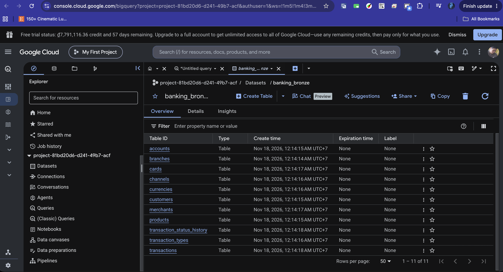

# BTVN 6 — Banking Bronze ELT

Homework Lesson 6:

1. **Phần 1** — SQL nghiệp vụ trong `part1_sql/`
2. **Phần 2** — Load Postgres → BigQuery tầng **Bronze** (mirror source, CREATE + MERGE idempotent)

```text
PostgreSQL core_banking → BigQuery banking_bronze → screenshot README
```

## Chuẩn bị

```bash
cd "lesson/lesson 6/BTVN_6"
python -m venv .venv
source .venv/bin/activate
pip install -r requirements.txt
cp .env.example .env
```

Sửa `.env`:

- `SOURCE_DB_*` — Postgres class (host/port hiện tại của lớp)
- `GOOGLE_APPLICATION_CREDENTIALS` — **đường dẫn tuyệt đối tới file SA JSON trên máy bạn** (path mẫu trong tài liệu lớp thường không tồn tại trên máy khác)
- `BQ_PROJECT_ID` — project BigQuery cá nhân / lớp
- `BQ_BRONZE_DATASET=banking_bronze`

## Chạy Phần 1

```bash
python run_part1.py
python run_part1.py q01_customers_hanoi.sql
```

## Chạy Phần 2 (Bronze)

```bash
python 00_check_connection.py
python run_pipeline.py
```

Hoặc từng bước:

```bash
python 01_init_bronze.py
python 02_load_bronze.py              # all tables
python 02_load_bronze.py customers    # one table
```

Idempotent: chạy `02_load_bronze.py` lần 2 — số row / PK không nhân đôi (MERGE theo PK).

## Cấu trúc

```text
BTVN_6/
├── part1_sql/                 # Phần 1
├── sql/
│   ├── 01_create_bronze_tables.sql
│   └── 02_merge_bronze_template.sql
├── config_tables.py
├── helper.py
├── 00_check_connection.py
├── 01_init_bronze.py
├── 02_load_bronze.py
├── run_pipeline.py
├── run_part1.py
└── README.md
```

## Screenshot BigQuery (Phần 2)

> Dán ảnh dataset `banking_bronze` (vài bảng có data) vào đây trước khi nộp.



## Ghi chú

- Chỉ làm **Bronze** — không tạo `banking_clean` / dims / facts trong BTVN này.
- Lab `Lesson_6_Lab_production` rộng hơn đề; BTVN dừng ở mirror source + MERGE.
